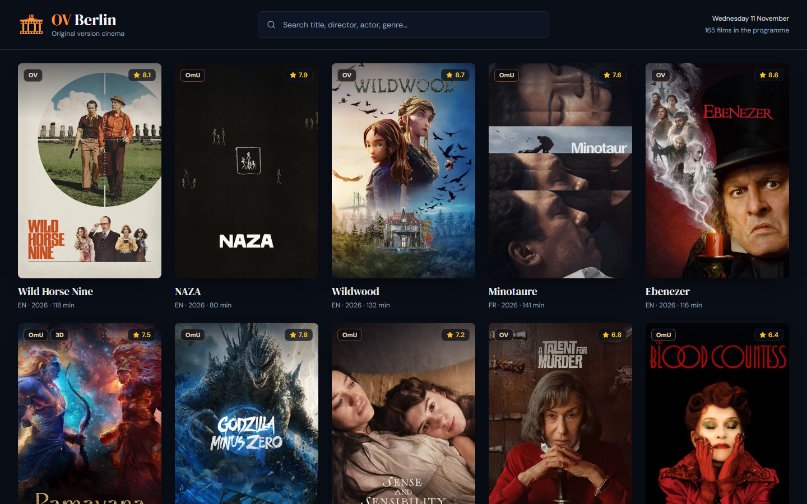
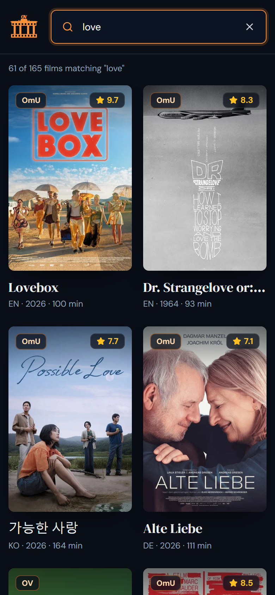
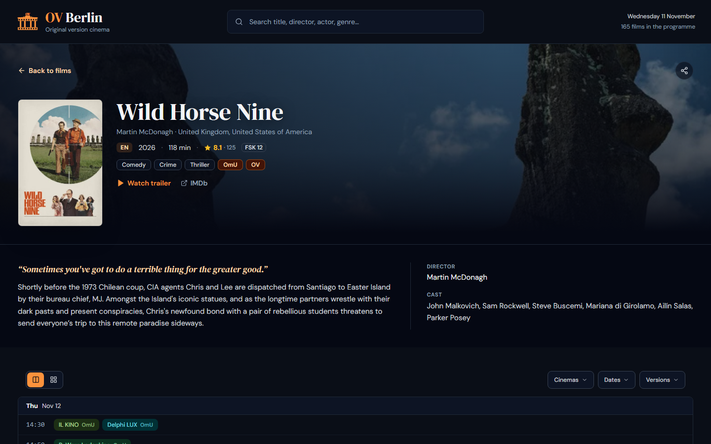
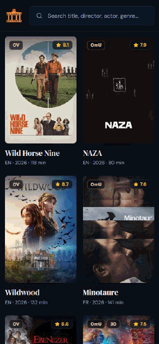

# OV Berlin

OV Berlin lists every original-version (OV) and subtitled (OmU) film showing in Berlin cinemas, with showtimes, ratings and trailers.

**[Open OV Berlin](https://ovberlin.online)** · [Docs](docs/)


## Features

<table>
<tr>
<td width="50%"></td>
<td><b>What is on now</b><br>Films sorted by upcoming showings, with language badges and IMDb ratings.</td>
</tr>
<tr>
<td width="50%"></td>
<td><b>Fuzzy search</b><br>One box searches titles, directors, cast, genres and plot.</td>
</tr>
<tr>
<td width="50%"></td>
<td><b>Film pages</b><br>Plot, cast, ratings, trailer link and every showtime, filtered by cinema, date and version.</td>
</tr>
<tr>
<td width="50%"></td>
<td><b>Cinema map</b><br>Tap a cinema to see it on a map, with directions and its website.</td>
</tr>
</table>

## Quick start

```sh
git clone https://github.com/santistebanc/berlin-cinema.git
cd berlin-cinema
npm install
npm run dev   # → http://localhost:3000
```

The dev server downloads the published dataset; it never starts a scrape. Running the scraper needs API keys: see [Development](docs/development.md#running-locally).

## How it's built

- **Frontend:** React 19, TypeScript, Vite and Tailwind CSS; Fuse.js searches in the browser; an installable PWA that works offline after the first load.
- **Data pipeline:** scrapers for critic.de and berlin.de keep every source observation; tested rules and a decision model resolve films, and nothing merges on similarity alone.
- **Metadata:** TMDb for films, OMDb for ratings, OpenStreetMap for cinemas; each value records its source and why it was chosen.
- **Hosting:** a static site on GitHub Pages; a Beelink server refreshes the data every six hours and hosts the review UI.

## More

- [Data pipeline](docs/data-pipeline.md): observe, interpret, resolve, enrich and publish, plus API data coverage.
- [Development, hosting and verification](docs/development.md): running locally, environment variables, releases, the public data audit and checks.
- [Source adapters](docs/source-adapters.md), [contracts](docs/source-contracts.md), [failure recovery](docs/source-recovery.md) and [ingestion rollout](docs/ingestion-rollout.md).
- [Media and capture config](docs/media/), refreshed with the project-showcase capture script.
