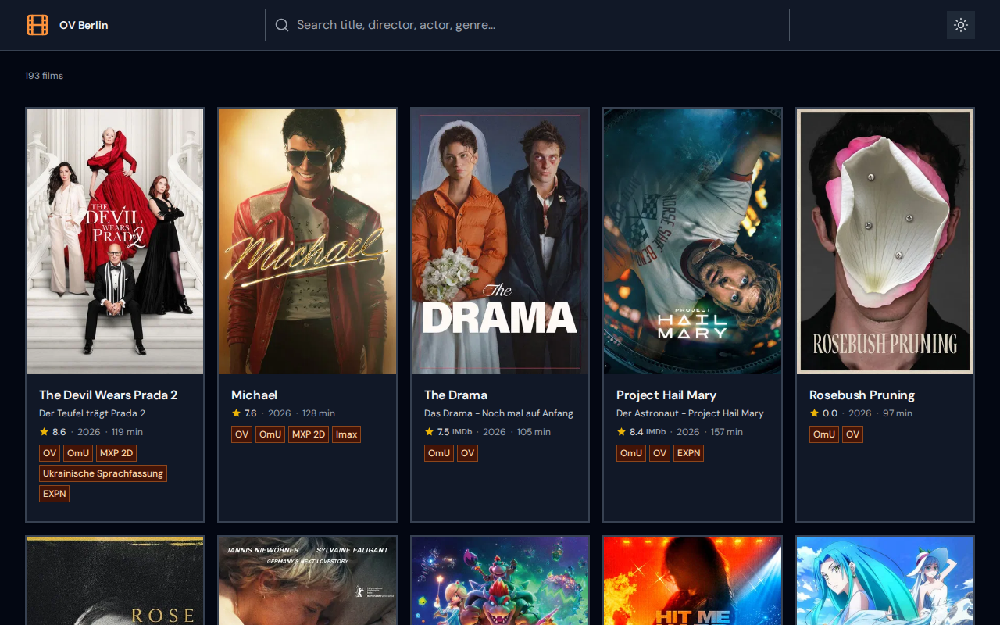
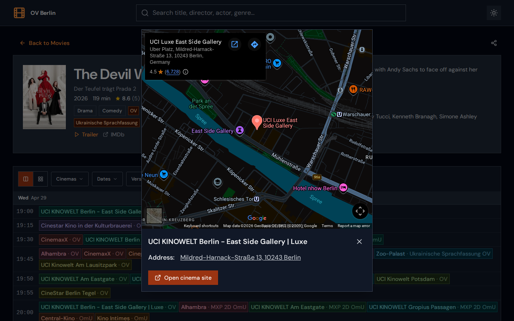
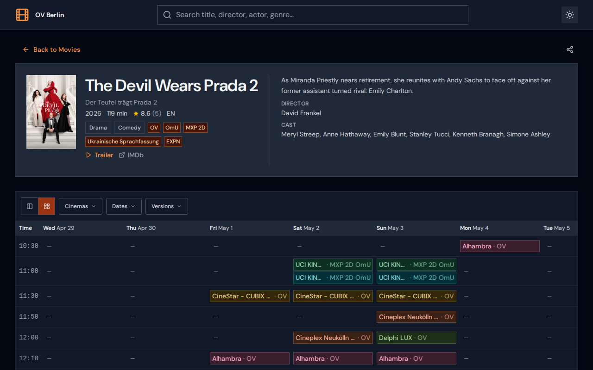
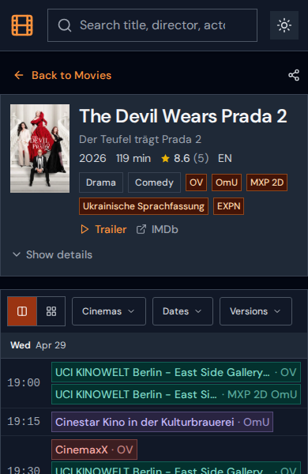
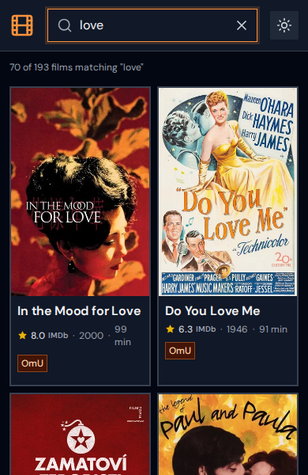

# OV Berlin

Browse what's playing in Berlin cinemas right now — original version (OV) and subtitled (OmU) films, with showtimes, ratings, trailers, and cinema info.

Live at **[ovberlin.online](https://ovberlin.online)**

| | |
|---|---|
|  |  |
|  |   |

## Features

### Browsing & search
- **Fuzzy search** across title, director, cast, genres, and plot
- Listings sorted by number of upcoming showings so the most active films surface first
- Scroll position preserved when navigating back from a movie detail page

### Movie detail
- Poster, backdrop, tagline, plot, runtime, age rating, year, country, director, cast
- **Ratings** — IMDb score with Rotten Tomatoes and Metacritic on hover/tap
- **Trailer** — links to the official YouTube trailer via TMDb
- **Share** — each movie has a unique URL with rich Open Graph previews (WhatsApp, Telegram, social media)

### Showtimes
- Two layouts: **stacked** (grouped by date) and **grid** (cinema × date matrix)
- Filter by **date**, **cinema**, and **format variant** (OV, OmU, Imax, MXP 2D, etc.)
- Showings from two sources merged and deduplicated: [critic.de](https://www.critic.de/ov-movies-berlin/) and [berlin.de](https://www.berlin.de/kino/)
- Format variants shown per showing — a single film can have OV, OmU, and MXP 2D OmU screenings listed separately

### Cinema info
- Tap any cinema name to open a popup with a **Google Maps embed** and direct **website link**
- Cinema websites from explicit source links and verified OpenStreetMap cinema records

### Other
- **Dark / light theme**
- **PWA** — installable on mobile and desktop, works offline after first load
- **Sitemap** generated on every data refresh for SEO

## How the data pipeline works

The public site remains static. GitHub Actions refreshes observations every six
hours; manual review runs only on your computer with `npm run admin`.

1. **Observe** — source adapters retain original labels, source URLs, distinct records and screening observations. Bounded detail-page requests retrieve explicit missing year/director data; cached details retain their original timestamps.
2. **Interpret** — tested rules recognize explicit language/format/year markers. Unknown parentheticals survive. A decision model classifies ambiguous source segments into bounded roles; it cannot invent an extracted name.
3. **Resolve** — stable internal IDs replace the canonical-name list. Established source links and supporting year/director/venue evidence can resolve records. Similarity retrieves candidates; it never automatically merges records. Model decisions can accept a supplied candidate, identify a distinct work, or abstain.
4. **Enrich** — TMDb searches use an explicitly supplied or previously verified original title first, with listing/translated titles as fallbacks. Alternate display labels are not assumed to be original titles. Searches return candidates, not an automatically selected film. Accepted identities supply metadata; OMDb uses the resulting verified IMDb ID. Derived identifiers are not independent confirmation of their own inference.
5. **Select fields** — each value records its source, original observation time and selection reason. Verified historical values can fill gaps within field-specific limits. Explicit manual clearing is different from missing source data. Old pre-migration enrichment stays unverified.
6. **Reconcile screenings** — the same resolved film/programme, cinema, date and time identify one viewing. Source descriptions combine automatically without model calls or screening-identity reviews, including different session/auditorium labels. Known details fill unspecified fields: `OmU` plus `OmenglU` retains explicit English subtitles. Contradictory language, subtitle, format or edition details remain unspecified; original observations and alternative descriptions are retained.
7. **Publish** — generate versioned static data, sitemap and public audit. A publication failure restores previous public files and the prior successful snapshot. Saved corrections remain available for retry.

Film identity also compares original source screenings using resolved cinema IDs,
before deduplicating viewings. The same cinema, date, time and complete normalized
film title establish one viewing despite mistakes in source credits or version
tags. Differently named listings can match when at least three distinctive shared
slots span two dates or cinemas and at least 90% of the smaller schedule overlaps.
Multiplex coincidences with other films do not count as distinctive without a
common, unambiguous auditorium. Duplicate source rows count once. Strong repeated
schedules take precedence over source title/year/director/cast claims, while
manual separations and conflicting verified external identities remain protected.
An independently verified peer can supply metadata to the matched source alias;
inherited metadata cannot become independent evidence for another inference.
Otherwise, matching source identities consolidate duplicate metadata reviews
while retaining their combined source evidence and API candidates for review.

Explicit Met broadcast, named film-festival, sneak-preview, shorts-programme and
film-series labels establish programme classification without a model request.
Unidentified programmes remain scoped to their source records until schedule
evidence consolidates them; their constituent films are not guessed from the
label. When two programme listings share essentially the same exclusive
cinema/date/time timetable (including one source republishing under multiple
listing URLs), they publish as one instance regardless of title wording. Partial
overlaps that do not cover either timetable stay separate. Exact generic labels such as `Festival`
can use a reversible special-programme fallback after successful detail checks
find no director, cast or year on the available records. Missing, failed or
unsupported checks retain review; credits found on another source prevent the
fallback. Later credits reclassify the listing while preserving its public ID.
`Operation` does not match the `opera` hint.
`PLF 2D` is a projection marker. Grammatical endings such as `Kurzfilm(e)` and
`Filmreihe(n)`, and the distinguishing qualifier `(Live Action)`, remain title text.
An alternate/display label from the same source can corroborate a retained title
qualifier without establishing a translation or screening language.

Bounded label variants at the exact same source URL can establish source-record
continuity without an exact title match. Conflicting identity evidence and manual
separations still prevent automatic linking. Existing public IDs and slugs are
retained when historical parser variants already created duplicate placeholders.
Missing decision-model configuration appears as a caution/status notice, while
individual unresolved evidence remains in the review queue.

Name fragments and shared words retrieve candidates only. API candidate/model
acceptance requires compatible independent credits/year evidence or separately
validated external identities; even a confident model cannot bypass this requirement.
Director comparisons use complete normalized credited names, including
co-directors and surname-first ordering; no nickname or substring inference is used.
A unique complete-title/director match can resolve an undated record. A year-only
disagreement can be reconciled when the complete title, director and at least two
cast members identify one work; the reported source year remains attributed.
Cast overlaps can corroborate a match; missing or disjoint partial
cast lists alone do not prove that two films differ. Retained TMDb detail bundles
can validate each source separately against director, cast and year, and distinct
validated IDs reject a proposed match. A search hit or differing search-result
sets alone never establish identity. Cinema links require physical address or
verified place/source identity evidence as well as compatible labels.

Publication also reconciles established duplicate source links. Independently
validated provider identities consolidate automatically. Without a provider ID,
compatible independent source credits/year can establish the same film. An exact
complete-title match across independent sources is also a fallback when it has
one compatible candidate and no contradictory identity evidence. Missing credits
are neutral. Formatting and known screening tags may be normalized, while sequel
numbers and distinguishing qualifiers remain. Same-source title-only records,
generic programmes, conflicting directors/years/IDs and ambiguous remakes stay
separate. Every member must be compatible with every other member;
chains through an ambiguous intermediary cannot join conflicting films. Manual
separations remain effective, screening formats survive, and unambiguous old
movie URLs remain aliases. Full provider credits support identity checks even
when matching actors fall outside the six-person display cast.

Films and cinemas publish `sourceAliases`: each source's record subject, URL,
external record ID when supplied, and exact labels attached to the resolved
public identity. Screenings reference `listingSubject` and `venueSubject` links
before reconciliation, rather than guessing a film or venue from a global name.
Saved aliases retain the resolved internal identity and evidence fingerprint;
later runs reuse the association while that evidence matches. The association
is persisted independently of the current snapshot, so it survives listings
disappearing and returning, or a corroborating source withdrawing. Changed evidence,
expired location verification and manual separations require re-evaluation;
public and internal identity IDs both respect separation decisions.
The original observations retain the source attribution/history. Resolved film
aliases can reuse a corroborated peer's verified metadata without another API
title search for an incomplete record. Unresolved source identity is not promoted
to a verified API candidate solely because a search returns the same name.

Cinema publication reconciles existing source links using matching complete
verified addresses and shared place evidence. A building ID alone cannot merge
cinemas: labels must also agree as whole words after bounded generic descriptors,
or each source must independently identify the same verified cinema POI. Provider
official/short-name aliases are retained, and branch aliases require address
corroboration. Conflicting house numbers, distinct known cinema IDs, ambiguous
match chains and manual corrections/separations prevent automatic consolidation.
An API cinema point and its building may use different number/range labels;
those reconcile only with matching complete retained source addresses, compatible
venue labels and a verified cinema identity, never number overlap or proximity.
Source links remain reversible; screenings reconcile under the shared venue ID.

Source detail requests prioritize URLs with open reviews within the 40-request
limit and deduplicate language/format variants. Critic.de's
`/ov-movies-berlin/movie/…` pages use the matching listing's production and credit
fields; other films on the page cannot supply evidence. Requests preserve the
source's stated production year even when it conflicts with another provider;
a re-release year is not silently converted into an original production year.
Identical credit blocks repeated for language variants at one exact URL are
usable; contradictory repeated blocks are withheld. A year-only change on an
already accepted source record can retain its identity only when its unchanged
URL/title and director plus cast independently revalidate the same cached
provider ID. The differing source year remains explicit evidence and a caution.
Recalculation consumes cached listing details before matching and retries missing
details for open review URLs and exact-title duplicate candidates with missing
credits within the same bound. Equal titles only trigger evidence retrieval;
they cannot establish identity. Detail fetches retain their
own timestamps and never renew listing or screening freshness.

### API data coverage

TMDb detail requests append credits, videos, external IDs, regional release dates,
keywords, translations, official alternative titles and images in one HTTP
request. Complete provider detail bundles stay cached, including full credits
and image/translation alternatives. The display projection includes production
countries, all directors, writers, spoken languages, release dates, German age
ratings, official trailers and external identities. Regional certifications
stay labelled; a US certificate cannot become a German FSK rating. Candidate
reviews receive these fields before acceptance, while unverified candidates
cannot supply published enrichment. Model requests use a smaller evidence
projection to control input cost. Verification and accepted enrichment reuse the
same detail response, and cache reads never renew its original fetch time.

OMDb exact-IMDb requests ask for the full plot and retain the complete response,
ratings and normalized film fields. Compatible OMDb values can fill missing
fields on an already verified film; nonempty preferred values remain intact.
Mismatched IMDb IDs/non-film responses are rejected. Failed requests remain
distinct from empty metadata and use a short retry cache.
Exact verified IMDb IDs with corroborating director/cast evidence also resolve
provider year or credit-spelling differences. Established preferred metadata is
retained, disputed OMDb dates are withheld, and ratings remain available. Actual
identity contradictions still withhold OMDb fields, including historical fallback.

Metadata reviews prioritize detail retrieval through their linked source records.
Transient source-detail responses receive one bounded retry at the original URL.
Searches prioritize whole-title results even below the top five, then compatible
years; candidates remain subject to independent evidence checks. Successful API
searches with no results retain source-only listings and an informational caution,
rather than asking for an identity decision with no candidate. Cached evidence
is checked during offline replays as well, so disabling network access cannot hide
an unresolved cached metadata conflict. Map-service outages are operational
cautions; individual unverified cinema locations still require review.
Unavailable optional OMDb enrichment is also an operational caution, while an
actual identity contradiction continues to require review.

OSM retains original tags and normalized address parts, aliases, contact details,
opening hours and accessibility. Geoapify retains complete returned candidate
evidence, partial address components and external IDs. Identity/contact fields
are attached to a cinema only after its identity is established; an address-only
mall/building match supplies geography. A precise named cinema/city point with
a verified non-Berlin state can establish exclusion even if the provider omits
its street address; missing street addresses inside Berlin remain unresolved.

`pipeline/state.json` is the durable, Git-versioned evidence/decision store.
It contains public source data, observations, links, resources, review issues,
corrections, a spending ledger and two recent snapshots. It contains no provider
credentials. Writers use a process lock and atomic file replacement; concurrent
writers are rejected. No SQLite, hosted database, authentication or hosted
editing server is required. The public build does not include the state file.

Source addresses are accepted automatically when their normalized street and
full house number match an OpenStreetMap address within Berlin. This also works
for an OSM building/address node without a cinema name. Spelling variants such as
`Str.`/`Straße` and `40–41`/`40/41` match; different numbers or conflicting
postcodes/cities do not. Address evidence confirms geography without merging
different cinemas sharing a building. Berlin.de cinema detail pages supply
missing addresses, cached for 30 days; OSM address requests are batched and cached.

Admin recalculation also fills missing venue addresses from retained source
records; it does not require a new listing scrape. Address detail fetches keep
their own timestamps and never renew screening freshness. Failed parsing,
failed requests and deferred lookups are distinguished in the review evidence.
Temporary venue request failures are cached for only five minutes, then retried
on the next fetch/recalculation. They are labelled as request failures rather
than presented as uncertainty about whether a cinema is in Berlin.
Bounded redirects to the same Berlin.de venue are followed; previously rejected
redirect responses are retried rather than kept as empty-address cache entries.

For unresolved locations, set `GEOAPIFY_API_KEY` in the project `.env` and restart
`npm run admin`. Geoapify searches the supplied address first, or the cinema name
when no address exists. Searches prefer the Berlin area but allow results
elsewhere in Germany. A separate administrative-boundary lookup confirms Berlin
state (`DE-BE`) or another German state; a city/postcode label alone is not the
Geoapify boundary check. Address-only matches never turn a mall/cafe/building
into a cinema identity. Ambiguous or imprecise place matches enter review.
Successful lookups are cached for 90 days; changed source evidence gets a new
lookup. Application defaults cap calls at 80 per run and reserve at most 1,000
credits/day, with throttling below the provider's free-plan rate limit. These
are conservative application limits, not a provider-account billing limit.
The review page reports configuration and reserved credits without exposing
the key. For scheduled refreshes, add the same `GEOAPIFY_API_KEY` repository
secret; the workflow already reads it. Geoapify/OSM attribution accompanies
location information supplied by that service.

If an address search fails, a structured cinema-name search runs separately;
the source address remains corroborating evidence rather than a search constraint.
This lets a precise cinema match correct a wrong source postcode. Singular/plural
`Kino`/`Kinos` labels match; omission of `Kinowelt` also requires an exact full
address match. An API label may omit a branch suffix only at a corroborated exact
street and full house number, with no conflicting postcode or city. A one-letter
street typo can be corrected only when another current source names the same full
cinema and exactly matches the API address; house number, postcode and city must
also agree with the original source. That source evidence and the original API
score are retained. Conflicting branch labels or house numbers remain separate.
Cached candidates are rechecked using these rules without repeating search calls.
Short/full city names
such as Brandenburg / Brandenburg an der Havel can agree only when their
postcodes, streets and full house numbers match.

If a source address changes, the cinema is looked up by name using Geoapify's
structured name/city parameters. A unique precise cinema match supplies the
authoritative address, even when it differs from the source. Merely finding the
source street address is insufficient in this case. Ambiguous or failed name
lookups remain flagged and unverified locations are withheld.

After a fresh `npm run scrape`, `npm run pipeline:cleanup` archives superseded
automatic review items and unlinked empty venue placeholders. It preserves
active unresolved records, original observations, manual corrections, verified
API caches and archive copies in the state resources. Failed/partial source
fetches never justify wiping previous usable observations.
`npm run pipeline:recheck-locations` retries missing source addresses, rechecks
resolvable cached failures, regenerates the listings and archives obsolete flags.

Screening reviews compare individual entries in separate columns, including
entries from the same source. Versions and language names use readable labels;
unspecified subtitle languages are distinguished from contradictory languages.

Only verified Berlin locations are published. Complete successful refreshes
withdraw support for omitted screenings; incomplete/failed refreshes do not.
Unsupported observations expire after 24 hours, including in old cached/PWA
snapshots. Dates/times are evaluated in Europe/Berlin. Absence is not cancellation.

## Stack

| Layer | Tech |
|---|---|
| Frontend | React 19, TypeScript, Vite, Tailwind CSS |
| Search | Fuse.js (client-side fuzzy search) |
| Scraping | Cheerio, Axios |
| Movie metadata | TMDb API |
| Ratings | OMDb API |
| Cinema data | OpenStreetMap / Overpass API |
| Hosting | GitHub Pages |
| CI/CD | GitHub Actions (every 6 hours) |

## Running locally

```bash
# Install dependencies
npm install

# Start the dev server at http://localhost:3000
npm run dev
```

Startup uses an existing local pipeline snapshot, or downloads the published
dataset from `https://ovberlin.online/movies.json`. It never starts a scrape or
spends model credits automatically. If the download fails, it keeps a valid
existing local dataset and prints a warning. Provider keys stay server-side.

To refresh just the local dataset while the server is running, run
`npm run data:sync` and reload the page.

To run the scraping and enrichment pipeline locally instead:

```bash
# Copy and fill in API keys (server-side only)
cp .env.example .env   # set TMDB_API_KEY and optionally OMDB_API_KEY

# Run the full scraper (writes public/movies.json)
npm run scrape

# Or run each step individually
npx tsx scripts/scrape-critic-de.ts   # writes data/critic-raw.json
npx tsx scripts/scrape-berlin-de.ts   # writes data/berlin-raw.json
npx tsx scripts/merge.ts              # merges, enriches, writes public/movies.json

# Recalculate from retained observations without scraping
npm run pipeline:replay

# Process cached raw files without replacing the public dataset
npm run pipeline:shadow -- --offline

# Start the local review server (builds the frontend first)
npm run admin
# Open http://127.0.0.1:3003/admin/review
```

GitHub Actions secrets cannot be read back through the GitHub settings page or API.
For direct local API calls, obtain keys from the providers and put them in `.env`
(which is ignored by git). A refresh without keys can reuse metadata previously
verified by this pipeline. Pre-migration inferred enrichment is retained for
inspection but is not silently accepted as a verified identity.

### Local review and rollout

The local server listens only on `127.0.0.1`. It accepts writes only from its own
browser origin and JSON forms. The public audit remains read-only. Review issues
retain source evidence, candidates and model outcomes; repeated runs update the
same issue. Changed evidence reopens a previously reviewed issue.

Use the queue to link or separate identities, correct parsed properties, select
a metadata candidate, correct a field, or reconcile screenings. Each item shows
a field-by-source comparison, with different values and missing data labelled
separately. Same-title records that have not been linked are marked as context.
The recorded rule, missing evidence, model confidence/threshold, API failure,
budget limit or missing provider explains why automation stopped; older runs
do not invent diagnostics they did not record. Choose a resolution or use the
custom form. Custom TMDb IDs/URLs are retrieved before they can be accepted.
Preview each change before applying it. Decisions persist until revoked, with source identity
changes flagged for another review. Applying/undoing a correction queues local
regeneration, with saved/processing/published/failed status. No source scrape is
needed. Unchanged decisions and resource lookups are reused.

Commit and push `pipeline/state.json` to propagate local corrections to Actions.
Pull the latest state before reviewing; if Git reports a state-file conflict,
keep both versions and reconcile the corrections rather than accepting a
whole-file replacement blindly. Git supplies the historical archive; current
state is loaded into memory. Partition the store if history grows substantially.

Pushing to `main` runs the production workflow: Node 24, `npm ci`, type checks,
tests, a fresh scrape, and the production build. Successful runs commit the
dataset, sitemap, public audit and `pipeline/state.json`, then deploy GitHub Pages.
Scheduled runs refresh the same data every six hours. The existing `TMDB_API_KEY`
and `OMDB_API_KEY` secrets are reused; optional `GEOAPIFY_API_KEY` enables extra
venue verification. No decision-model credentials are required: deterministic
rules run normally and ambiguous evidence stays available for local review.

Actions and local `npm run scrape` default to **live publication**. An explicit
repository variable `PIPELINE_MODE=shadow` withholds the new dataset (but still
commits resolver state and deploys the frontend). `pipeline:shadow` also withholds
the dataset. If all enabled sources fail, the scrape fails before merging; a
failed scrape or build stops deployment. A single failed source can use retained
observations within their existing freshness limit. The manual `skip_scrape`
option deploys the committed dataset as-is.

### Decision model research and evaluation

The initial candidate is **Cloudflare Clef-flash**, a native decision model
returning choices/probability distributions rather than generated prose.
First-party prices checked on 15 October 2026:

| Adapter / model | USD per million input tokens | Output charge |
|---|---:|---|
| [Cloudflare Clef-flash](https://developers.cloudflare.com/workers-ai/models/clef-flash/) | 0.038 | None |
| [TypeSafe Jev](https://typesafe.ai/) | 0.042 | Input-based pricing |
| [OpenAI Decisions / GPT-6 Luna](https://developers.openai.com/api/docs/guides/decisions#pricing-and-availability) | 0.10 | None |
| [Cloudflare Clef](https://developers.cloudflare.com/workers-ai/models/clef/) | 0.24 | None |

Cloudflare reports stronger results than Jev on several benchmarks, but also
reports tasks where Jev wins. These are vendor measurements, not evidence that
Clef-flash is best for cinema identity resolution. See the
[release benchmarks](https://blog.cloudflare.com/clef-decision-models/).
Perplexity's [open-weight decider](https://huggingface.co/perplexity-ai/pplx-decider-v1.1-27b)
also reports gains over Jev, but its published serving instructions require a
large CUDA GPU. Its model card does not establish a cheap hosted endpoint, so it
was not selected for this small deployment. Rankings do not replace task-specific tests.

The three HTTP adapters share one bounded decision interface. Switching provider
does not change extraction or identity rules. No stronger-model escalation is
implemented. Source text is untrusted input; provider output choices and complete
probability distributions are validated.

```bash
npm run pipeline:eval          # deterministic parsing fixtures; no model calls
npm run pipeline:eval -- --live # labeled decision fixtures; requires provider key
npm test                      # source, identity, persistence, review and publication tests
```

`pipeline/evaluation-fixtures.ts` contains source-inspired and synthetic cases,
including held-out comparisons. Reports go to ignored `data/evaluations/` and
separate correctness, accepted decisions, unsafe matches, latency and cost. No
live benchmarking has been performed without credentials. The default 0.97
confidence/probability threshold is provisional; inspect accepted errors and
review rate on representative held-out data before enabling live publication.

The application reserves conservative spend before a call and retains that
reservation after an ambiguous timeout. Completed usage settles the reservation.
Materially unchanged decisions are cached across fresh observation timestamps;
changed evidence, model, question/policy or threshold invalidates the cache.
The default USD 8 monthly allowance leaves room below the requested EUR 10
budget, but does not control unrelated provider-account usage or exchange rates.
An exhausted allowance defers new decisions to review while extraction continues.

### Scraper flags

| Flag | Effect |
|---|---|
| `--force-enrich` | Re-fetch TMDb and OMDb data even if already cached |
| `--skip-berlin-de` | Skip fetching berlin.de; retained observations still follow freshness rules |

## Environment variables

| Variable | Required | Description |
|---|---|---|
| `TMDB_API_KEY` | For local enrichment | [TMDb API key](https://www.themoviedb.org/settings/api) — metadata, posters, trailers |
| `OMDB_API_KEY` | No | [OMDb API key](https://www.omdbapi.com/apikey.aspx) — IMDb, Rotten Tomatoes, Metacritic ratings |
| `DECISION_PROVIDER` | No | `cloudflare` (default), `typesafe`, or `openai` |
| `DECISION_MODEL` | No | Provider default; see `.env.example` |
| `CLOUDFLARE_ACCOUNT_ID`, `CLOUDFLARE_API_TOKEN` | For Clef | Workers AI account/token; server-side only |
| `TYPESAFE_API_KEY`, `OPENAI_API_KEY` | For alternatives | Only the selected provider's key is used |
| `DECISION_THRESHOLD` | No | Provisional acceptance threshold, default `0.97` |
| `DECISION_MONTHLY_USD_LIMIT` | No | Application allowance, default `8` |
| `ADMIN_PORT` | No | Local review port, default `3003` |

## Public data audit

The read-only audit workspace is at `/admin` locally and at `/admin/` after the
next deployment. It is intentionally public and exposes only public listing
data and sanitized matching evidence. It has no editing or scrape-trigger API.

- **Latest changes** (`/admin`) shows only changes in the last run compared with
  the preceding run. An unchanged run has no listed changes; a baseline has no
  predecessor and is not presented as newly added data.
- **Cinemas** (`/admin/cinemas`) and **Movies** (`/admin/movies`) have separate lists. Open a record
  for its details, source observations, viewings, and individual value histories
  with dated before/after values. Retired records and viewings remain inspectable.
  Related matching/API evidence includes retained legacy decisions, identity
  links, bounded model decisions, external identity groups, TMDb candidates,
  and cache/fallback decisions, when captured by the pipeline.
- **Versions / Tags** (`/admin/versions`) groups equivalent explicit labels with
  the same parser used by the resolver. It shows meanings, raw source labels,
  confirmed and source-only viewing counts, and related viewings. `OF`/`OV` and
  `OmenglU`/`OmeU` share canonical entries; generic `OmU` stays distinct from
  explicit English subtitles. Language, projection, edition and event tags remain
  separate dimensions. Unknown markers and conflicting descriptions are retained
  without being promoted to confirmed tags, and a viewing counts once per tag.

`npm run audit:seed` initializes a baseline from the existing movie snapshot if
tracking has not started. Build and local startup run this automatically.
Baseline records predate tracking: their true creation and change dates are
unknown. Historical Git snapshots have not been backfilled. An imported
published dataset cannot reconstruct the original extraction or API search
decisions; those are labeled unavailable rather than inferred from a URL.

Each full scrape writes `public/audit/index.json` and an immutable report in
`public/audit/runs/`. The deployment workflow commits these alongside the movie
data, including failed-refresh reports, so history survives deployments.
Do not delete these files to refresh data. Run a single scraper/writer at a time.
No database or running backend is needed: Git is the durable store, Actions is
a scheduled writer, local review writes corrections, and Pages serves static files. A per-record report index lets
the browser fetch only relevant history rather than every historical run.
Builds upgrade older indexes from their existing reports without inventing
events. No automatic retention policy is applied. For a much larger archive,
the static index and reports can be partitioned while retaining this architecture.

A screening is one movie/cinema/date/time slot with all its format variants.
"No longer listed" means absent from the latest output, not a cancellation.
Cached observations retain their extraction timestamp; repeated observations
do not count as content updates. Re-importing identical published data does not
create a synthetic refresh. Failed refreshes preserve the last successful audit
entity snapshot.
